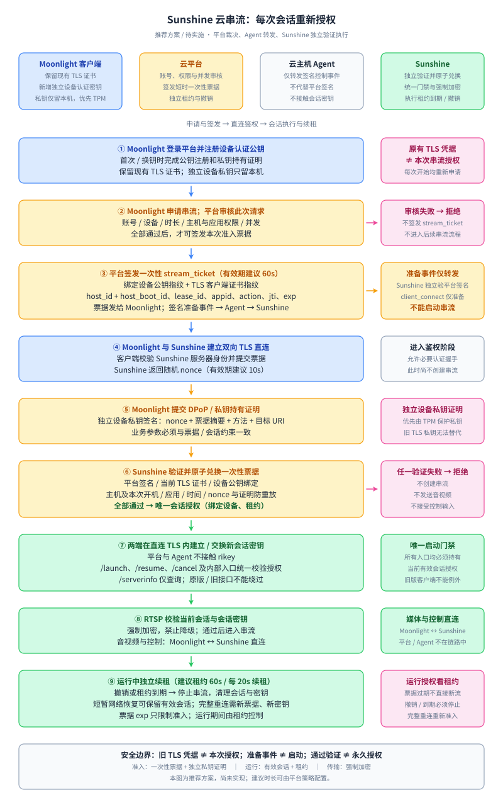

# 串流前认证流程

本图描述拟议的安全改造方案，尚不代表当前代码已经实现。

- 原有 Moonlight TLS 证书用于连接身份认证；每次串流还必须通过平台授权与独立设备私钥持有证明。
- 平台签名的准备事件经 Agent 转发，Sunshine 独立验签；准备事件本身不启动串流。
- 会话密钥只在 Moonlight 与 Sunshine 的直连 TLS 通道中建立或交换，平台和 Agent 不接触密钥。
- 所有启动路径必须执行相同的授权检查；认证失败时不创建串流、不发送音视频、不接受控制输入。
- 票据、挑战与租约的时间参数为建议初始值。启动票据的期限和运行中租约的期限分别管理。
